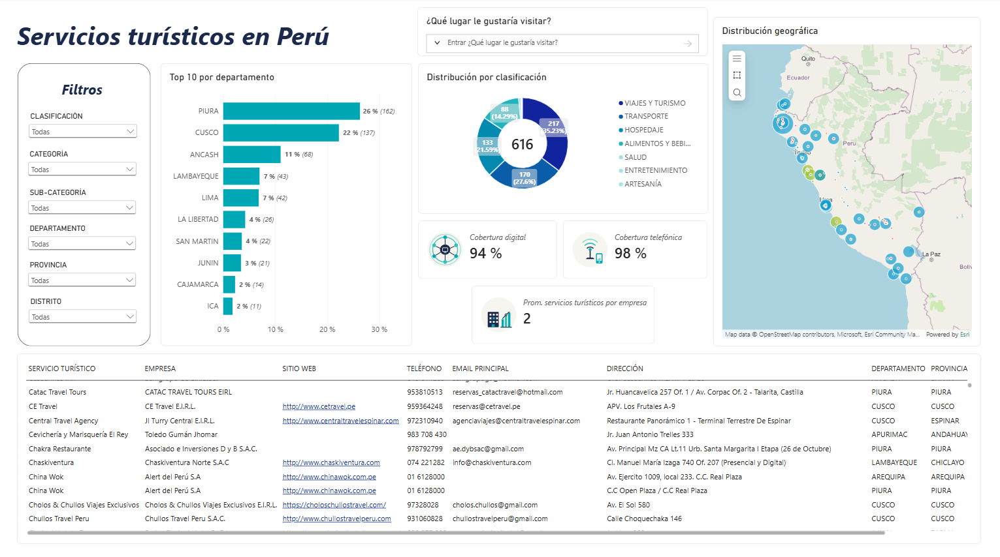
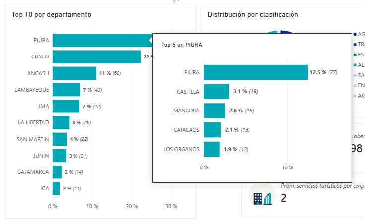
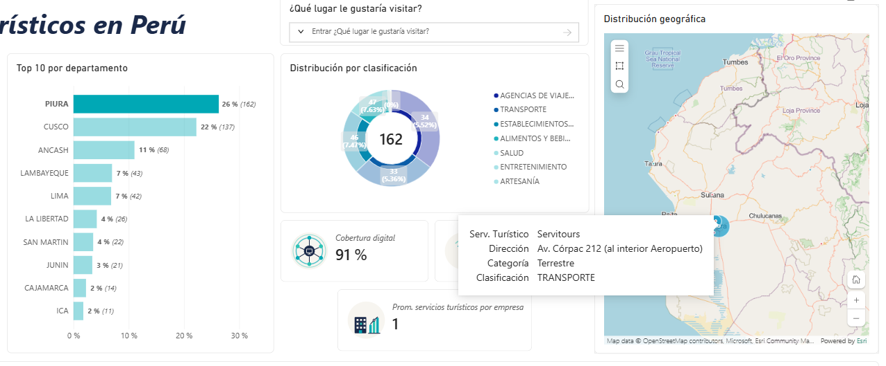
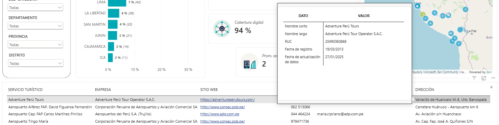
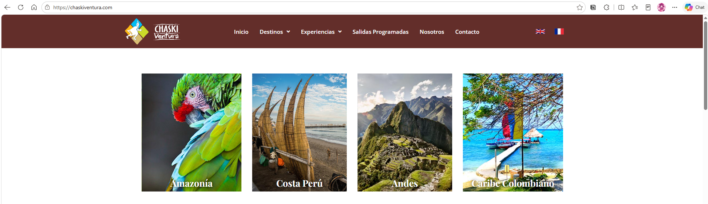
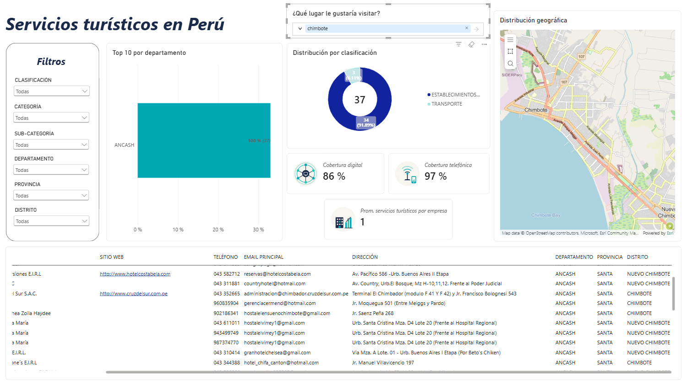

# Servicios Turísticos en Perú




## 1. Descripción del proyecto
Este proyecto consiste en el desarrollo de un dashboard que facilite la utilización de la información compartida por Estado Peruano mediante su Plataforma Nacional de Datos Abiertos; de tal manera que, los ciudadanos puedan identificar fácilmente qué servicios turísticos se encuentran disponibles en el Perú y así orientar su actividad turística. Este proyecto posteriormente puede mejorarse al incluir información sobre las atracciones y costumbres de cada localidad, incluso fechas en las que se celebran los eventos zonales.

**VERSIÓN 1.0**

### 1.1. Más detalle del dashboard
1. Top de servicios turísticos por departamento y distrito
    

2. Selección de servicios turísticos por clasificación
    

3. Medios de contacto y detalle de la empresa
    
    

4. Búsqueda de servicios turísticos por palabra
    

### 1.2. Contenido del proyecto
- Archivo editable del dashboard (.pbix)
- [Archivo fuente (proveniente de la Plataforma Nacional de Datos) (.csv)](https://www.datosabiertos.gob.pe/dataset/empresas-de-servicios-tur%C3%ADsticos-registradas-o-actualizadas-por-iper%C3%BA-durante-2025-comisi%C3%B3n)
- Archivo procesado (separación de tablas de hechos y dimensiones) (.xlsx)
- Archivos listos para importar en Power BI (.csv)
    - servicios_turisticos - CATEGORÍA.csv
    - servicios_turisticos - CLASIFICACIÓN.csv
    - servicios_turisticos - EMPRESA.csv
    - servicios_turisticos - SERVICIO_TURÍSTICO.csv
    - servicios_turisticos - SUBCATEGORÍA.csv
- [Archivo complementario de UBIGEO (proveniente de repositorio GitHub)](https://github.com/jmcastagnetto/ubigeo-peru-aumentado)
- [Diccionario de datos (preveniente de la Plataforma Nacional de Datos) (.xlsx)](https://www.datosabiertos.gob.pe/dataset/empresas-de-servicios-tur%C3%ADsticos-registradas-o-actualizadas-por-iper%C3%BA-durante-2025-comisi%C3%B3n)
- [Metadatos del origen (.docx)](https://www.datosabiertos.gob.pe/dataset/empresas-de-servicios-tur%C3%ADsticos-registradas-o-actualizadas-por-iper%C3%BA-durante-2025-comisi%C3%B3n)

## 2. Estado del proyecto


## 3. Tecnologías utilizadas


## 4. Guía de instalación
1. Clonar el repositorio en su carpeta de preferencia:
    ```
    https://github.com/caroSeminario23/Servicios_turisticos_Peru.git
    ```

2. Abrir el dashboard en su aplicación de escritorio.


## 5. Licencia
[](./LICENSE)

## 6. Colaboradores
- Carolina Seminario (caroSeminario23)

<a href="https://github.com/caroSeminario23/Servicios_turisticos_Peru/graphs/contributors">
  
</a>